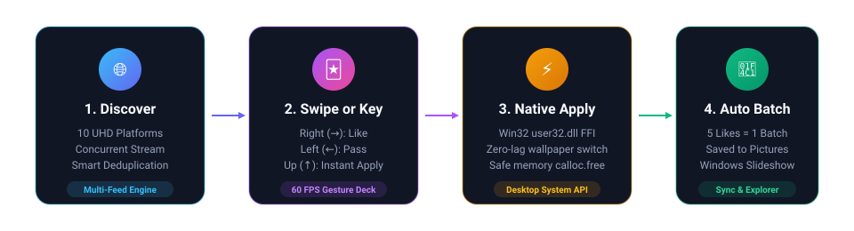

# Wall Gem 💎

<p align="center">
  <strong>A lightning-fast, gesture-driven 4K wallpaper discovery engine & desktop personalization suite.</strong>
  <br />
  <em>Crafted with Flutter, Clean Architecture, and direct native OS kernel hooks (Win32 FFI, macOS System Events, Linux desktop managers).</em>
</p>

<p align="center">
  <a href="https://github.com/arashgholiyan/wall-gem/releases/latest">
    
  </a>
  
  
  
  
  
</p>

<p align="center">
  <a href="https://github.com/arashgholiyan/wall-gem/releases/latest">
    
  </a>
</p>

---

## 💡 Why I Built Wall Gem

Like many software engineers and desktop ricing enthusiasts, I spend upwards of 10 hours a day sitting in front of my displays. A great desktop wallpaper isn't just decoration—it sets the tone for deep focus, creative momentum, and a clean workstation.

But actually *finding* high-resolution wallpapers has become a frustrating chore:
- Web galleries buried under slow countdown timers, fake download buttons, and cookie banners.
- Browser tabs easily eating 2GB+ of memory just to browse a handful of images.
- Desktop wallpaper utilities that are either 800MB Electron shells, ad-supported bloatware, or sketchy services running in the background 24/7.

**Wall Gem** is the application I always wished existed:
1. **Snappy & Tactile**: A fluid **60 FPS gesture-driven card deck** that makes exploring art and photography effortless.
2. **Native & Lightweight**: Direct OS kernel syscalls via **Win32 C-FFI** (`user32.dll`) that switch desktop backgrounds in under 50ms with zero resident background services eating CPU or RAM.
3. **Respectful & Privacy-First**: No accounts to register, no telemetry, no tracking cookies, and no personal API keys required.
4. **Hackable**: Export color palettes directly into Pywal or CSS for your terminal and window manager, with human-readable JSON configs you can sync via Git.

<p align="center">
  
</p>

---

## ✨ Features

### 🃏 60 FPS Tactile Swipe Deck
Browse wallpapers with fluid card physics, spring curves, and keyboard hotkeys. Like with <kbd>→</kbd>, pass with <kbd>←</kbd>, or set your wallpaper immediately with <kbd>↑</kbd>. If you accidentally pass an image you loved, hit <kbd>Z</kbd> to pop it back from the undo history stack.

### 🏛️ The Favorites Vault (Local Gallery Grid)
Switch between the card deck and your offline local gallery anytime (`[ 🃏 Deck ] [ 🏛️ Vault ]`). Filter saved favorites with real-time keyword search (title, artist, tags) and category chips. Everything is stored in human-readable JSON at `Pictures/WallGem/favorites.json`—no binary database lock-in.

### 🎨 Dynamic Color Palette & "Ricing" Exporter
Extract dominant colors from any wallpaper with a single click. View visual swatches and copy ready-to-paste configurations for:
- **Pywal (`.Xresources`)**: For terminal emulators and Linux ricing setups.
- **CSS Custom Properties (`:root`)**: For custom web dashboards and UI themes.
- **JSON**: Machine-readable format for scripts and automations.
- **Hex CSV**: Clean comma-separated color codes.

### ☀️ Day & Night Dynamic Sun Cycle
Your desktop aesthetic flows with the sun:
- **Daytime (`06:00–19:59`)**: Automatically prioritizes sun-drenched landscapes, architecture, and vibrant scenery.
- **Nighttime (`20:00–05:59`)**: Switches recommendations to deep AMOLED Dark, Cyberpunk, and Space themes to soothe eye strain during late-night sessions.
- Easily toggle on/off with the sun/moon icon in the navigation bar.

### ⏱️ Scheduled Interval Auto-Cycler
Prefer a hands-free desktop slideshow? Choose an interval from the header dropdown (*Off*, *15m*, *30m*, *1h*, *4h*) and Wall Gem will smoothly cycle through fresh curation in the background without battery or memory leaks.

### 🖥️ Multi-Monitor & Ultrawide Splitter
Rocking a 21:9 or 32:9 panoramic monitor? Wall Gem detects ultrawide aspect ratios, displays a `🖥️ 21:9+` badge, and calculates clean Left/Right screen bisection slices saved to `Pictures/WallGem/MultiMonitor/`.

### 🌐 10 Concurrent Provider Feeds
Streams ultra-high-definition wallpapers simultaneously across 10 high-resolution endpoints with asynchronous pooling and real-time URL deduplication:
- WallpapersWide • WallpapersCraft • AlphaCoders • 4K Wallpapers • WallpaperHub
- Birdpaper 4K • Wallhaven • Bing Daily Archives • Windows Spotlight • Picsum 5K

---

## 🔄 Architectural Workflow

<p align="center">
  
</p>

---

## ⌨️ Keyboard Shortcuts

Wall Gem is designed keyboard-first for fast desktop navigation:

| Key | Action | Behavior |
| :---: | :--- | :--- |
| <kbd>→</kbd> | **Like** | Save wallpaper to Favorites Vault and batch tray |
| <kbd>←</kbd> | **Pass** | Dismiss card to history stack |
| <kbd>↑</kbd> | **Apply Now** | Download & set as desktop background instantly via Win32 FFI |
| <kbd>Z</kbd> | **Undo** | Restore the previously dismissed card |
| <kbd>Space</kbd> | **Lightbox Zoom** | Open high-res inspection, palette exporter & monitor splitter |
| <kbd>R</kbd> | **Refresh** | Fetch fresh batch from current source platform |

---

## 🏗️ Architecture & Engineering Choices

Wall Gem follows Uncle Bob's **Clean Architecture** with strict unidirectional data flow:

```
┌─────────────────────────────────────────────────────────────┐
│                      PRESENTATION LAYER                     │
│    HomeScreen  •  SwipeableCardStack  •  FavoritesVaultView │
│    PaletteExportModal  •  ActionDock  •  Responsive Header   │
│   State: WallpaperDeckProvider, FavoritesProvider, Action   │
└──────────────────────────────┬──────────────────────────────┘
                               │ (calls use cases / repos)
┌──────────────────────────────▼──────────────────────────────┐
│                         DOMAIN LAYER                        │
│   Entities: Wallpaper, FavoriteWallpaper                    │
│   Contracts: IWallpaperRepository, IFavoritesRepository    │
│   Platform Contract: IWallpaperPlatformService              │
└──────────────────────────────▲──────────────────────────────┘
                               │ (implements)
┌──────────────────────────────┴──────────────────────────────┐
│                          DATA LAYER                         │
│   FavoritesStorageService (atomic favorites.json store)     │
│   PaletteFormatService (Pywal, CSS, JSON, Hex Exporter)     │
│   MultiMonitorSplitterService (21:9 & 32:9 geometry)       │
│   10 Remote Data Sources & Fallback Repositories            │
│   Platform Services Factory:                                │
│   ├─ WindowsWallpaperService (user32.dll Win32 FFI)         │
│   ├─ MacOSWallpaperService (AppleScript System Events)      │
│   └─ LinuxWallpaperService (GNOME / KDE / XFCE / feh)       │
└─────────────────────────────────────────────────────────────┘
```

### Key Engineering Decisions:
- **Win32 C-FFI instead of shell execution**: Spawning PowerShell commands (`Set-ItemProperty`) introduces a 400–800ms process spin-up lag. Calling `SystemParametersInfoW` directly through Dart FFI executes in **<50ms**, with manual UTF-16 pointer allocation and immediate `calloc.free` cleanup.
- **Lightweight JSON over SQLite**: Storing bookmarks in SQLite creates opaque binary files. Saving to `favorites.json` keeps your data readable, easily editable in any text editor, and simple to backup via Git.
- **100% Hermetic Test Suite**: All remote datasources and platform services accept injected HTTP clients and process runners, allowing **70 unit and widget tests** to run in under 15 seconds on CI with zero external network flakiness.

---

## 🚀 Quickstart

### Prerequisites
- [Flutter SDK](https://flutter.dev) (v3.24+ recommended)
- Windows 10/11, macOS, or Linux desktop environment

### Running from Source
```bash
# 1. Clone the repository
git clone https://github.com/arashgholiyan/wall-gem.git
cd wall-gem

# 2. Fetch packages
flutter pub get

# 3. Launch the desktop app
flutter run -d windows
```

### Running Tests & Static Analysis
```bash
# Code formatting check
dart format --output=none --set-exit-if-changed .

# Static code analysis (0 issues)
flutter analyze

# Execute 70 unit and widget tests
flutter test
```

---

## 🤝 Let's Build Together!

Wall Gem is an independent, open-source project. If you're into desktop customization, Linux ricing, or Flutter desktop development, I would love to collaborate with you!

Here are a few exciting areas where contributions and ideas are warmly welcomed:
- 🐧 **Linux Wayland Setters**: Native integrations for `swww`, `hyprpaper`, or `mpvpaper`.
- 🍎 **macOS Dynamic Desktop**: Integration with native macOS wallpaper CLI utilities.
- 🖥️ **Windows 11 Virtual Desktops**: Per-monitor background switching via the `IDesktopWallpaper` COM interface.
- 🔌 **Custom Sources**: Adding plugins for your own self-hosted image servers or community feeds.

Feel free to open an [Issue](https://github.com/arashgholiyan/wall-gem/issues) to start a discussion, share feedback, or submit a Pull Request!

- **Author**: [Arash Gholiyan](https://github.com/arashgholiyan)
- **Guidelines**: See [CONTRIBUTING.md](CONTRIBUTING.md) and [CODE_OF_CONDUCT.md](CODE_OF_CONDUCT.md)

---

## ⚖️ Legal, Copyright & Responsible Indexing Notice

### 1. Non-Hosting & Client-Side Operation
Wall Gem is an open-source, client-side indexing and desktop personalization utility. **Wall Gem does not host, store, cache on remote servers, or redistribute any copyrighted media or image files.** All media assets, thumbnails, and images are retrieved directly on demand by the end-user's device from publicly accessible third-party endpoints and content delivery networks.

### 2. Intellectual Property & Copyright Ownership
All images, artwork, photography, and wallpapers accessible through this client remain the exclusive intellectual property and copyright of their respective authors, photographers, creators, and platforms. Display within Wall Gem does not grant or imply any transfer of ownership or licensing rights.

### 3. Fair Use & Educational Purpose
This software is provided for personal, non-commercial, and educational purposes under the [MIT License](LICENSE). The indexing of publicly accessible web feeds is performed in good faith under fair use doctrine.

### 4. Trademark Notice
*Windows* and *Microsoft* are registered trademarks of Microsoft Corporation. All other trademarks, service marks, trade names, and logos referenced or displayed within this repository and application belong to their respective owners. Wall Gem is an independent open-source project and is not affiliated with, endorsed by, or sponsored by any referenced company or platform.

### 5. Content Removal & Takedown Requests
If you are a copyright holder, artist, or platform administrator and wish to request the exclusion or removal of your content feed or domain from Wall Gem's default indexer, please open a GitHub Issue or contact the maintainer at [github.com/arashgholiyan](https://github.com/arashgholiyan). Your request will be honored and the source endpoint will be promptly removed from the codebase within 24–48 hours.

---

## 📄 License

Distributed under the **MIT License**. See [LICENSE](LICENSE) for details.
